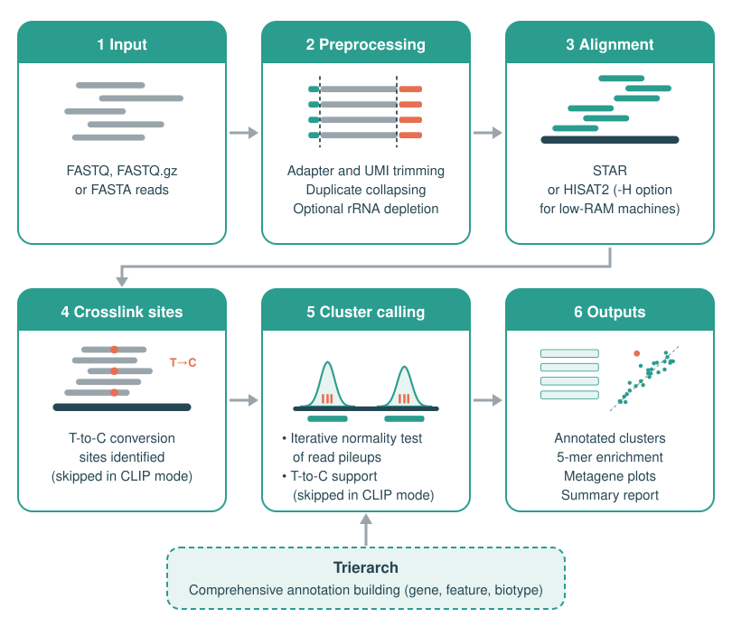
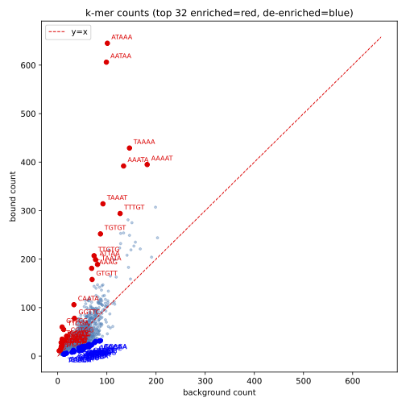
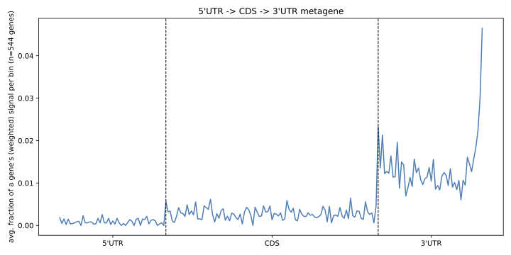

<h1 align="center">
  PARALUS<br>
  <sub>A Lightweight Unix Shell Pipeline for PAR-CLIP and CLIP Sequencing Data Analysis</sub>
</h1>

<p>
  <a href="https://github.com/KonstantinidouP/PARALUS/releases/latest"></a>
  
  
  
</p>

PARALUS is a bash-based pipeline for the analysis of PAR-CLIP and CLIP sequencing data. It performs end-to-end processing from raw reads to annotated RNA-binding protein (RBP) binding sites, and includes k-mer enrichment analysis to identify sequence preferences.

## Contents

- [Overview](#overview)
- [Features](#features)
- [Performance & Accessibility](#performance--accessibility)
- [Dependencies](#dependencies)
- [Quick Start](#quick-start)
- [Parameters](#parameters)
- [Output files](#output-files)
- [Example Output](#example-output)

Other guides: [INSTALLATION.md](INSTALLATION.md) | [REFERENCE_SETUP.md](REFERENCE_SETUP.md)

---

## Overview

PARALUS takes CLIP or PAR-CLIP sequencing data as input and outputs RBP binding sites (clusters) with full annotation, crosslink site information, and binding statistics. The pipeline handles adapter trimming, duplicate read collapsing, genome alignment, T-to-C crosslink site extraction (relevant for PAR-CLIP data), peak calling with read distribution modeling, and genomic annotation - all in a single run.

PARALUS includes **Trierarch**, a companion annotation module that generates a custom annotation BED file directly from a Gencode/Ensembl GTF file. Trierarch is embedded in the same script and can be run standalone using the `--trierarch` mode, or triggered within a PARALUS run by providing a GTF file with the `-G` flag.

<p align="center">
  
</p>

---

## Features

- Analyzes both PAR-CLIP and CLIP data (CLIP mode with `-c 0 -r 0`)
- Runs on Linux and macOS
- Handles multiple input formats: FASTQ, FASTQ.gz, and FASTA
- Optional UMI trimming and adapter removal via cutadapt
- Optional rRNA depletion by pre-mapping to an rRNA genome index
- Genome alignment with STAR, or with HISAT2 (`-H`, low-RAM machines option)
- T-to-C crosslink site extraction from PAR-CLIP data at single-nucleotide resolution
- Two-stage peak calling based on read distribution modeling that filters out artifacts and background
- Built-in annotation module (Trierarch); supports canonical transcripts only (`-C`), optional tRNA (`-T`) and miRNA (`-M`) databases
- Resolution of overlapping annotations by priority-ranked feature assignment
- Gene name, feature, biotype, read counts, and T-to-C conversion metrics per cluster
- 5-mer enrichment analysis at binding sites vs. background, with optional PDF scatter plot output
- Metagene analysis plots for UTR/CDS and intron binding distribution (optional PDF output)
- Per-sample statistics report including binding breakdown by gene feature type
- Full run logging to a timestamped log file

---

## Performance & Accessibility

PARALUS is designed to be fast, self-contained, and accessible - running on any Linux or Mac machine with a single command. Genome alignment with STAR requires sufficient RAM to load the genome index (~30 GB for human hg38). A minimum of 32 GB RAM is therefore recommended for human or mouse genome analysis on a local machine with STAR.

**Low-RAM option.** On machines with limited RAM (less than 32 GB), use the `-H` flag to align with HISAT2 instead of STAR. See [INSTALLATION.md](INSTALLATION.md) for installing HISAT2 and building a HISAT2 index, and the `-H` entry in `paralus --help` for details. HISAT2 needs far less memory and recovers the same biological signal: on CPSF1, both aligners showed the 3'UTR binding spike and enrichment of the AATAAA polyadenylation signal. HISAT2 reports fewer clusters (845 vs. 1,241 with STAR), so STAR is recommended when memory allows and maximum sensitivity matters.

PARALUS was benchmarked on three publicly available fPAR-CLIP datasets on an Apple MacBook Pro (M4 Pro, 48 GB RAM) using 4 threads (`-p 4`):

| Dataset | Input FASTQ.gz size | Raw reads | Unique reads (after collapsing) | Runtime (minutes) | CPU |
|---|---|---|---|---|---|
| CPSF1 (SRR13313335) | 238 MB | 9,135,633 | 2,142,567 | 2:29.85 (~2.5 min) | 113% |
| KHSRP (SRR13313340) | 559 MB | 19,992,492 | 8,878,651 | 7:06.72 (~7.1 min) | 173% |
| U2AF1 (SRR8606876) | 1.4 GB | 54,284,359 | 10,680,775 | 14:21.47 (~14.4 min) | 147% |

Runtime scales with input size and library complexity (unique reads remaining after collapsing duplicates), ranging from ~2.5 minutes for a 238 MB dataset to ~14.4 minutes for a 1.4 GB dataset. CPU utilization of 113-173% shows that part of the run uses multiple cores. All analyses completed on a local Mac laptop without requiring access to an HPC cluster.

> **Note:** Alignment and sorting steps benefit from additional threads (set with `-p`), but some steps such as peak calling and 5-mer counting are inherently serial. On local machines, disk speed and available RAM can be as important as CPU core count. Running PARALUS on a Linux server can be beneficial when analyzing large datasets or batch processing multiple samples.

---

## Dependencies

PARALUS requires the following tools installed in your environment:

- [STAR](https://github.com/alexdobin/STAR) (tested with v2.7.11b) **or** [HISAT2](http://daehwankimlab.github.io/hisat2/) (alternative aligner, selected with `-H` - recommended if you have less than 32 GB RAM)
- [samtools](http://www.htslib.org/) (tested with v1.22.1)
- [bedtools](https://bedtools.readthedocs.io/) (tested with v2.31.1)
- [cutadapt](https://cutadapt.readthedocs.io/)
- python3 (OPTIONAL - required for PDF plot output)
- matplotlib (OPTIONAL - required for PDF plot output)
- numpy (OPTIONAL - required for PDF plot output)

For step-by-step installation instructions across different environments (Apple Silicon Mac, Linux machines/servers, HPC clusters), see [INSTALLATION.md](INSTALLATION.md).

---

## Quick Start

### Step 1 - Install PARALUS and its dependencies

Clone the repository to any location on your machine, then add the PARALUS folder to your `PATH` (the list of folders your terminal searches for programs), so you can run PARALUS as `paralus` from any folder. The last three lines add two lines to your shell settings file, a label and the `PATH` setting. Run them from inside the PARALUS folder:

```bash
git clone https://github.com/KonstantinidouP/PARALUS.git
cd PARALUS
echo "# Added for PARALUS - delete this line and the next one to undo" >> ~/.bashrc
echo "export PATH=\"$PWD:\$PATH\"" >> ~/.bashrc
source ~/.bashrc
```

On a Mac, use `~/.zshrc` instead of `~/.bashrc`.

Check that it worked:

```bash
paralus --help
```

Then install the dependencies into a conda environment called `paralus`. The installer checks which tools you already have and asks before installing anything:

```bash
bash install_dependencies.sh
```

Activate the environment before each run:

```bash
conda activate paralus
```

For manual installation, HPC clusters and other details, see [INSTALLATION.md](INSTALLATION.md).

### Step 2 - Prepare the reference files (once per genome)

PARALUS needs:
- the genome FASTA (`-f`)
- a genome index (`-x`)
- a gene annotation: a GTF (`-G`) or a BED file built with Trierarch (`-A`)
- optionally, an rRNA index for rRNA depletion (`-e`)

If you don't have them yet, see [REFERENCE_SETUP.md](REFERENCE_SETUP.md) for downloading the relevant files and building the indexes, including HISAT2 indexes for the low-RAM option.

### Step 3 - Run PARALUS

Make sure you have activated the `paralus` environment (`conda activate paralus`), or loaded the modules if you're on an HPC cluster. If you haven't installed the dependencies yet, see [Step 1](#step-1---install-paralus-and-its-dependencies).

**Option A - using a pre-built annotation BED file:**

```bash
paralus \
  -i /path/to/sample.fastq.gz \
  -x /path/to/genome_index \
  -A /path/to/annotation_Paralus.bed \
  -f /path/to/genome.fa \
  -e /path/to/rRNA_index \
  -a NNTGACTGTGGAATTCTCGGGTGCCAAGG \
  -u 4 \
  -p 12

# -e (rRNA depletion) is optional
```

**Option B - using a GTF directly (Trierarch builds the annotation first):**

```bash
paralus \
  -i /path/to/sample.fastq.gz \
  -x /path/to/genome_index \
  -G /path/to/gencode.gtf \
  -T /path/to/hg38-tRNAs.bed \
  -C \
  -f /path/to/genome.fa \
  -e /path/to/rRNA_index \
  -a NNTGACTGTGGAATTCTCGGGTGCCAAGG \
  -u 4 \
  -p 12

# -e (rRNA depletion) is optional
```


---

## Parameters

### Required

| Flag | Description |
|------|-------------|
| `-i` | Path to the input file (FASTQ.gz / FASTQ / FASTA). Output files are written to the same folder. |
| `-x` | Path to genome index (STAR genomeDir by default; a HISAT2 index basename if `-H` is set) |
| `-A` | Path to the annotation BED file generated by Trierarch - required unless `-G` is used |
| `-f` | Path to the genome FASTA file (uncompressed) |

### Preprocessing

| Flag | Description | Default |
|------|-------------|---------|
| `-a` | 3' adapter sequence | none |
| `-d` | 5' adapter sequence | `GTTCAGAGTTCTACAGTCCGACGATC` |
| `-u` | Bases to trim from 5' end (UMIs) | `0` |
| `-n` | Minimum read length after trimming | `19` |
| `-p` | Threads | `8` |
| `-e` | Path to rRNA genome index for pre-depletion (STAR genomeDir, or HISAT2 basename if `-H` is set) | none |
| `-H` | Use HISAT2 instead of STAR for all alignment steps. Option for low-RAM machines. HISAT2 needs ~8 GB RAM to build the index and ~5 GB to align. `-x`/`-e` must then be HISAT2 index basenames (see [INSTALLATION.md](INSTALLATION.md)) | off |

### Annotation

The following flags are only relevant when `-G` is set:

| Flag | Description |
|------|-------------|
| `-G` | Path to GTF file - Trierarch will build the annotation BED before alignment (replaces `-A`) |
| `-T` | tRNA BED file from GtRNAdb - used with `-G` to include tRNA annotations (optional) |
| `-M` | miRNA GFF3 file from miRBase, or a BED6 file in the same format as `-T` - used with `-G` to include miRNA annotations (optional) |
| `-C` | Use canonical/MANE transcripts only - used with `-G`, recommended for GENCODE/Ensembl |
| `-U` | Keep genes with no `gene_name` attribute, using their Ensembl accession (e.g. `ENSG...`) as the display name instead - used with `-G`. Off by default; without it, unnamed genes are excluded from the annotation BED and any clusters overlapping them appear as unannotated. |

### Cluster calling

| Flag | Description | Default |
|------|-------------|---------|
| `-m` | Minimum reads to define a group | `3` |
| `-c` | Minimum T-to-C conversion locations per cluster | `1` |
| `-r` | Minimum fraction of T-to-C reads per cluster | `0.3` |

> **CLIP mode:** Set both `-c 0` and `-r 0` to run PARALUS in CLIP mode (no T-to-C signal expected). In this mode, T-to-C extraction is skipped and all groups are promoted to clusters. Both flags must be set to `0` together - setting only one to `0` will produce an error.

---

## Output files

| File | Description |
|------|-------------|
| `*.Aligned.sortedByCoord.out.bam` (+`.bai`) | Full genome alignment. |
| `*.aligned_TtoC.bam` (+`.bai`) | Subset of aligned reads carrying a T-to-C conversion. Empty in CLIP mode. |
| `*.aligned_TtoC.bed` | T-to-C crosslink-supporting reads in BED format. Empty in CLIP mode. |
| `*.groups.csv` | Every candidate group, before cluster-threshold filtering (`-c`/`-r`). |
| `*.clusters.csv` | Final annotated PAR-CLIP / CLIP binding sites: genomic coordinates, annotated gene name, feature type (e.g. 3'UTR, CDS, intron), biotype (e.g. protein_coding, lncRNA), binding sequence, read counts, and T-to-C conversion metrics, per row. |
| `*.clusters.bed` | BED version of the clusters file. |
| `*_run_<timestamp>.log` | Full stdout/stderr of the run, plus the exact invoked command. |
| `*_stats.txt` | Run parameters, total runtime, and summary counts (reads per biotype/feature, cluster counts, etc). |
| `*_5mers.txt` | Raw bound and background 5-mer counts. |
| `*_5mer_ratios.tsv` | Bound vs. background enrichment ratio per 5-mer, ranked from most to least enriched. |
| `*_5mer_enrichment.pdf` | Scatter plot illustrating 5-mer enrichment. Only generated if python3 with numpy and matplotlib are installed. |
| `*_ttoc_utr_cds.pdf` | Metagene plot of crosslinked read distribution across 5'UTR → CDS → 3'UTR. In CLIP mode, this plot shows the distribution of all aligned reads instead. Only generated if python3 with numpy and matplotlib are installed. |
| `*_ttoc_intron.pdf` | Metagene plot of crosslinked read distribution across introns (5' splice site → 3' splice site). In CLIP mode, this plot shows the distribution of all aligned reads instead. Only generated if python3 with numpy and matplotlib are installed. |
| `rRNA_aligned_*.bam` | Only if `-e` was used: reads that mapped to the rRNA reference. Retained for cases where rRNA binding is of biological interest. |

---

## Example Output

The following example shows PARALUS output from a PAR-CLIP experiment with CPSF1 (Cleavage and Polyadenylation Specificity Factor 1), using publicly available data (SRR13313335; Anastasakis et al., *Nucleic Acids Research* 2021, PMID: 33503264). CPSF1 is a component of the cleavage and polyadenylation complex known to recognize the canonical AAUAAA polyadenylation signal sequence on precursor messenger RNA (pre-mRNA). The predominant binding at 3'UTRs is consistent with its known function, and the enrichment of AATAAA (the DNA equivalent of AAUAAA) is clearly visible in the 5-mer scatter plot.

**Terminal output** - summary printed at the end of the CPSF1 run (`paralus_1.8.7.sh`, STAR, `-p 4`):

```
PARALUS finished successfully
  Binding sites (clusters): 1241
  Run time: 2m 28s
  Results in: /path/to/CPSF1_fromGEO_SRR13313335
```

**5-mer enrichment scatter plot** - each of the 1024 pentamers is plotted by its count in bound sequences (y-axis) vs. background sequences (x-axis). Pentamers enriched at binding sites fall above the diagonal; depleted ones fall below. The AATAAA polyadenylation signal is represented among the top enriched 5-mers.



**Metagene plot** - distribution of T-to-C crosslink sites across the 5'UTR, CDS, and 3'UTR of protein-coding genes, normalized by region length. A distinct spike at the 3' end of the 3'UTR reflects CPSF1's binding at the cleavage and polyadenylation site.



---

## Repository structure

```
PARALUS/
├── paralus_1.8.7.sh         # Main pipeline script (includes Trierarch)
├── paralus                  # Launcher: runs the pipeline script as `paralus`
├── install_dependencies.sh  # Dependency installer (Linux and Apple Silicon Mac)
├── INSTALLATION.md          # Detailed dependencies installation instructions for all environments
├── REFERENCE_SETUP.md       # Reference genome, annotation and rRNA index setup
├── PARALUS_manual.md        # Extended manual with full parameter reference and troubleshooting
├── images/                  # Workflow figure and example output plots (CPSF1) shown in this README
└── README.md
```

---

## Citation

> **[Manuscript in preparation]**
> Konstantinidou P, Benhalevy D, Sarshad AA, Anastasakis DG. PARALUS: A Lightweight Unix Shell Pipeline for PAR-CLIP and CLIP Sequencing Data Analysis. *Journal TBD*, year.

If you use PARALUS in your work, please cite the above once published.

---

## Authors

- **Dimitrios Anastasakis** - lead developer
- **Parthena Konstantinidou** - co-developer

---

## License

> **[Placeholder - license to be decided]**
>
> For now, this repository is private. License will be added prior to public release.
